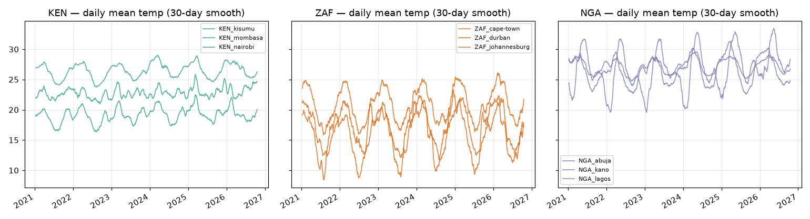
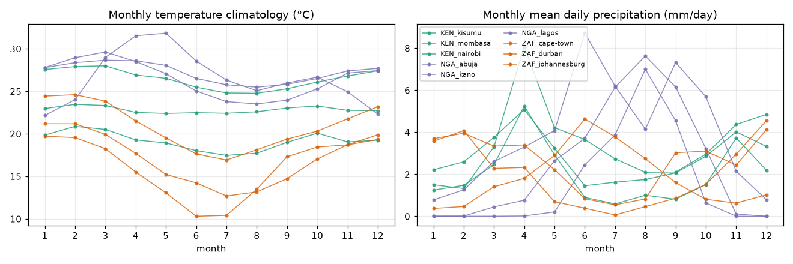
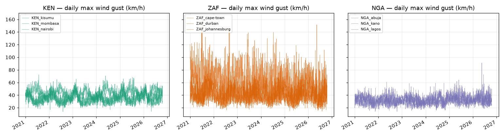

# Day 9 — EDA: pilot-city weather panel

Generated by `python -m src.eda.weather_eda` on 2026-10-19T14:15:30+00:00.

**Inputs:** Day 3 archive (Open-Meteo ERA5, 2021-01-01 .. 2026-10-18; 9 cities; up to
50808 hourly rows each; 0 gaps/nulls per the Day 3 audit).
Units: °C, mm, km/h, hPa (Open-Meteo defaults).

## Figures

## Per-city extremes

| country   | city         |   days | hottest_day         | wettest_day           | gustiest_day            |
|:----------|:-------------|-------:|:--------------------|:----------------------|:------------------------|
| KEN       | Kisumu       |   2117 | 2025-03-05 (27.7°C) | 2022-01-17 (56.0 mm)  | 2025-02-20 (65.9 km/h)  |
| KEN       | Mombasa      |   2117 | 2024-03-13 (29.9°C) | 2025-10-30 (124.7 mm) | 2021-07-25 (72.4 km/h)  |
| KEN       | Nairobi      |   2117 | 2025-03-07 (23.7°C) | 2026-03-20 (39.1 mm)  | 2025-02-22 (59.8 km/h)  |
| NGA       | Abuja        |   2117 | 2025-03-03 (32.9°C) | 2026-08-13 (42.8 mm)  | 2025-04-27 (61.9 km/h)  |
| NGA       | Kano         |   2117 | 2026-05-05 (34.9°C) | 2022-08-02 (70.6 mm)  | 2026-05-17 (91.1 km/h)  |
| NGA       | Lagos        |   2117 | 2024-04-28 (30.4°C) | 2021-07-16 (76.0 mm)  | 2025-07-12 (55.4 km/h)  |
| ZAF       | Cape Town    |   2117 | 2026-03-11 (32.7°C) | 2022-06-13 (72.0 mm)  | 2021-07-08 (162.7 km/h) |
| ZAF       | Durban       |   2117 | 2025-01-04 (31.0°C) | 2022-05-21 (126.4 mm) | 2025-06-10 (90.7 km/h)  |
| ZAF       | Johannesburg |   2117 | 2024-12-04 (27.7°C) | 2021-12-27 (46.3 mm)  | 2024-10-27 (86.0 km/h)  |

## Wettest and hottest month per city (climatology)

| city | country | wettest month | hottest month |
|---|---|---|---|
| Kisumu | KEN | 4 (5.1 mm/day) | 2 (23.5 °C) |
| Mombasa | KEN | 4 (8.1 mm/day) | 3 (28.0 °C) |
| Nairobi | KEN | 4 (5.2 mm/day) | 2 (20.9 °C) |
| Abuja | NGA | 8 (7.6 mm/day) | 3 (29.6 °C) |
| Kano | NGA | 8 (7.0 mm/day) | 5 (31.8 °C) |
| Lagos | NGA | 6 (8.7 mm/day) | 3 (28.7 °C) |
| Cape Town | ZAF | 6 (4.6 mm/day) | 1 (21.2 °C) |
| Durban | ZAF | 12 (4.1 mm/day) | 2 (24.6 °C) |
| Johannesburg | ZAF | 12 (4.5 mm/day) | 1 (19.7 °C) |

## Inter-city correlation — daily mean temperature (9x9)

| city_key         |   KEN_kisumu |   KEN_mombasa |   KEN_nairobi |   NGA_abuja |   NGA_kano |   NGA_lagos |   ZAF_cape-town |   ZAF_durban |   ZAF_johannesburg |
|:-----------------|-------------:|--------------:|--------------:|------------:|-----------:|------------:|----------------:|-------------:|-------------------:|
| KEN_kisumu       |         1    |          0.27 |          0.47 |        0.21 |       0.03 |        0.17 |            0.19 |         0.18 |               0.18 |
| KEN_mombasa      |         0.27 |          1    |          0.68 |        0.76 |      -0.04 |        0.72 |            0.68 |         0.63 |               0.49 |
| KEN_nairobi      |         0.47 |          0.68 |          1    |        0.57 |       0.01 |        0.5  |            0.53 |         0.49 |               0.51 |
| NGA_abuja        |         0.21 |          0.76 |          0.57 |        1    |       0.22 |        0.88 |            0.65 |         0.62 |               0.42 |
| NGA_kano         |         0.03 |         -0.04 |          0.01 |        0.22 |       1    |        0.27 |           -0.22 |        -0.2  |              -0.32 |
| NGA_lagos        |         0.17 |          0.72 |          0.5  |        0.88 |       0.27 |        1    |            0.57 |         0.57 |               0.34 |
| ZAF_cape-town    |         0.19 |          0.68 |          0.53 |        0.65 |      -0.22 |        0.57 |            1    |         0.61 |               0.5  |
| ZAF_durban       |         0.18 |          0.63 |          0.49 |        0.62 |      -0.2  |        0.57 |            0.61 |         1    |               0.77 |
| ZAF_johannesburg |         0.18 |          0.49 |          0.51 |        0.42 |      -0.32 |        0.34 |            0.5  |         0.77 |               1    |

Within-country pairwise correlation: KEN_kisumu–KEN_mombasa: 0.27; KEN_kisumu–KEN_nairobi: 0.467; KEN_mombasa–KEN_nairobi: 0.678; NGA_abuja–NGA_kano: 0.223; NGA_abuja–NGA_lagos: 0.884; NGA_kano–NGA_lagos: 0.267; ZAF_cape-town–ZAF_durban: 0.607; ZAF_cape-town–ZAF_johannesburg: 0.501; ZAF_durban–ZAF_johannesburg: 0.769

## Annual means (trend / coverage)

| country   | city         | city_key         |   year |   days |   temp_mean |   precip_total |   gust_max |
|:----------|:-------------|:-----------------|-------:|-------:|------------:|---------------:|-----------:|
| KEN       | Kisumu       | KEN_kisumu       |   2021 |    365 |       22.69 |          945.2 |       60.1 |
| KEN       | Kisumu       | KEN_kisumu       |   2022 |    365 |       22.21 |         1051.3 |       61.9 |
| KEN       | Kisumu       | KEN_kisumu       |   2023 |    365 |       22.8  |          979.2 |       65.5 |
| KEN       | Kisumu       | KEN_kisumu       |   2024 |    366 |       22.78 |          977.1 |       57.6 |
| KEN       | Kisumu       | KEN_kisumu       |   2025 |    365 |       23.17 |          997.6 |       65.9 |
| KEN       | Kisumu       | KEN_kisumu       |   2026 |    291 |       23.39 |          980.4 |       59   |
| KEN       | Mombasa      | KEN_mombasa      |   2021 |    365 |       26.03 |          947.3 |       72.4 |
| KEN       | Mombasa      | KEN_mombasa      |   2022 |    365 |       26.04 |          889.2 |       64.8 |
| KEN       | Mombasa      | KEN_mombasa      |   2023 |    365 |       26.38 |         1541.9 |       59   |
| KEN       | Mombasa      | KEN_mombasa      |   2024 |    366 |       26.95 |         1478.6 |       70.6 |
| KEN       | Mombasa      | KEN_mombasa      |   2025 |    365 |       26.62 |         1326   |       68.4 |
| KEN       | Mombasa      | KEN_mombasa      |   2026 |    291 |       26.61 |         1019.5 |       60.8 |
| KEN       | Nairobi      | KEN_nairobi      |   2021 |    365 |       18.63 |          817.9 |       52.9 |
| KEN       | Nairobi      | KEN_nairobi      |   2022 |    365 |       18.67 |          451.3 |       52.2 |
| KEN       | Nairobi      | KEN_nairobi      |   2023 |    365 |       19.28 |          682.6 |       54   |
| KEN       | Nairobi      | KEN_nairobi      |   2024 |    366 |       19.44 |          754.9 |       52.6 |
| KEN       | Nairobi      | KEN_nairobi      |   2025 |    365 |       19.56 |          769.2 |       59.8 |
| KEN       | Nairobi      | KEN_nairobi      |   2026 |    291 |       19.37 |          707.4 |       51.8 |
| NGA       | Abuja        | NGA_abuja        |   2021 |    365 |       26.28 |          761.6 |       47.9 |
| NGA       | Abuja        | NGA_abuja        |   2022 |    365 |       25.74 |         1113.9 |       50.4 |
| NGA       | Abuja        | NGA_abuja        |   2023 |    365 |       26.29 |          858.5 |       46.4 |
| NGA       | Abuja        | NGA_abuja        |   2024 |    366 |       26.77 |          727.4 |       46.8 |
| NGA       | Abuja        | NGA_abuja        |   2025 |    365 |       26.98 |          973.4 |       61.9 |
| NGA       | Abuja        | NGA_abuja        |   2026 |    291 |       26.84 |         1188.6 |       49   |
| NGA       | Kano         | NGA_kano         |   2021 |    365 |       26.22 |          348.4 |       53.3 |
| NGA       | Kano         | NGA_kano         |   2022 |    365 |       25.33 |          766.7 |       60.5 |
| NGA       | Kano         | NGA_kano         |   2023 |    365 |       26.23 |          606.7 |       58.7 |
| NGA       | Kano         | NGA_kano         |   2024 |    366 |       26.19 |          545.7 |       59   |
| NGA       | Kano         | NGA_kano         |   2025 |    365 |       27.63 |          663.3 |       64.1 |
| NGA       | Kano         | NGA_kano         |   2026 |    291 |       28.49 |          499.6 |       91.1 |
| NGA       | Lagos        | NGA_lagos        |   2021 |    365 |       27.22 |         1216.1 |       51.5 |
| NGA       | Lagos        | NGA_lagos        |   2022 |    365 |       26.7  |         1213   |       51.8 |
| NGA       | Lagos        | NGA_lagos        |   2023 |    365 |       27.13 |         1519.8 |       48.6 |
| NGA       | Lagos        | NGA_lagos        |   2024 |    366 |       27.48 |         1262.3 |       53.6 |
| NGA       | Lagos        | NGA_lagos        |   2025 |    365 |       27.24 |         1645.5 |       55.4 |
| NGA       | Lagos        | NGA_lagos        |   2026 |    291 |       27.49 |         1569.5 |       50.8 |
| ZAF       | Cape Town    | ZAF_cape-town    |   2021 |    365 |       16.77 |          829.5 |      162.7 |
| ZAF       | Cape Town    | ZAF_cape-town    |   2022 |    365 |       17.03 |          552.6 |      145.4 |
| ZAF       | Cape Town    | ZAF_cape-town    |   2023 |    365 |       16.65 |          845.4 |      139   |
| ZAF       | Cape Town    | ZAF_cape-town    |   2024 |    366 |       17    |          710.4 |      139.7 |
| ZAF       | Cape Town    | ZAF_cape-town    |   2025 |    365 |       17.65 |          574.1 |      118.8 |
| ZAF       | Cape Town    | ZAF_cape-town    |   2026 |    291 |       17.24 |          482.4 |      151.6 |
| ZAF       | Durban       | ZAF_durban       |   2021 |    365 |       20.35 |          985.9 |       85.7 |
| ZAF       | Durban       | ZAF_durban       |   2022 |    365 |       20.53 |         1257.2 |       78.1 |
| ZAF       | Durban       | ZAF_durban       |   2023 |    365 |       20.77 |          975   |       74.5 |
| ZAF       | Durban       | ZAF_durban       |   2024 |    366 |       21.19 |          749.3 |       88.9 |
| ZAF       | Durban       | ZAF_durban       |   2025 |    365 |       20.99 |         1025.3 |       90.7 |
| ZAF       | Durban       | ZAF_durban       |   2026 |    291 |       21.51 |          491.6 |       84.2 |
| ZAF       | Johannesburg | ZAF_johannesburg |   2021 |    365 |       15.62 |          847.8 |       84.6 |
| ZAF       | Johannesburg | ZAF_johannesburg |   2022 |    365 |       15.54 |          794.6 |       76.7 |
| ZAF       | Johannesburg | ZAF_johannesburg |   2023 |    365 |       16.14 |          561.9 |       73.8 |
| ZAF       | Johannesburg | ZAF_johannesburg |   2024 |    366 |       17    |          318.6 |       86   |
| ZAF       | Johannesburg | ZAF_johannesburg |   2025 |    365 |       16.18 |          955   |       75.6 |
| ZAF       | Johannesburg | ZAF_johannesburg |   2026 |    291 |       15.79 |          575.6 |       68.8 |

## Findings

- **Seasonality differs sharply by country** — wettest month per city: Kisumu→M4, Mombasa→M4, Nairobi→M4, Abuja→M8, Kano→M8, Lagos→M6, Cape Town→M6, Durban→M12, Johannesburg→M12. Kenya's long rains, South Africa's austral-summer rainfall and Nigeria's May–Oct monsoon are all visible; month-of-year is therefore a legitimate calendar feature, not a leak.
- **Warmest climatological city:** Kano (31.8 °C mean). **Highest single-day gust observed:** ZAF_cape-town on 2021-07-08 (162.7 km/h). **Wettest climatological month:** Lagos (8.7 mm/day).
- **Within-country temperature correlation ranges 0.223–0.884** — three cities per country are *not* interchangeable replicates in the lower range, so country models can keep all three (check variance inflation when features are built, Day 16).
- **Daily-max gust distributions are heavy-tailed** (figure 3): a handful of days carry most exposure — models must treat gusts as event-like, and any gust feature should use rolling maxima, not long means.
- **No missing days anywhere** (Day 3 audit), so rolling features on Day 16 need no gap handling for weather.
- These are ERA5 grid values at ~city-centroid resolution (see `src/ingestion/weather.py`); they describe exposure, not the local fault that caused any specific outage.
