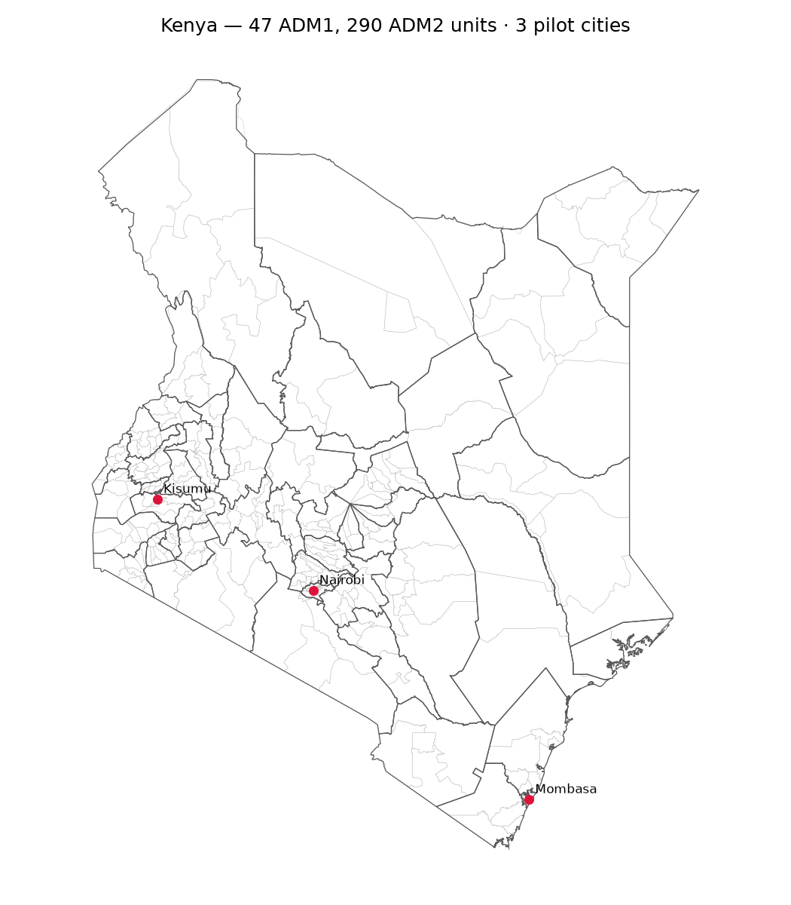
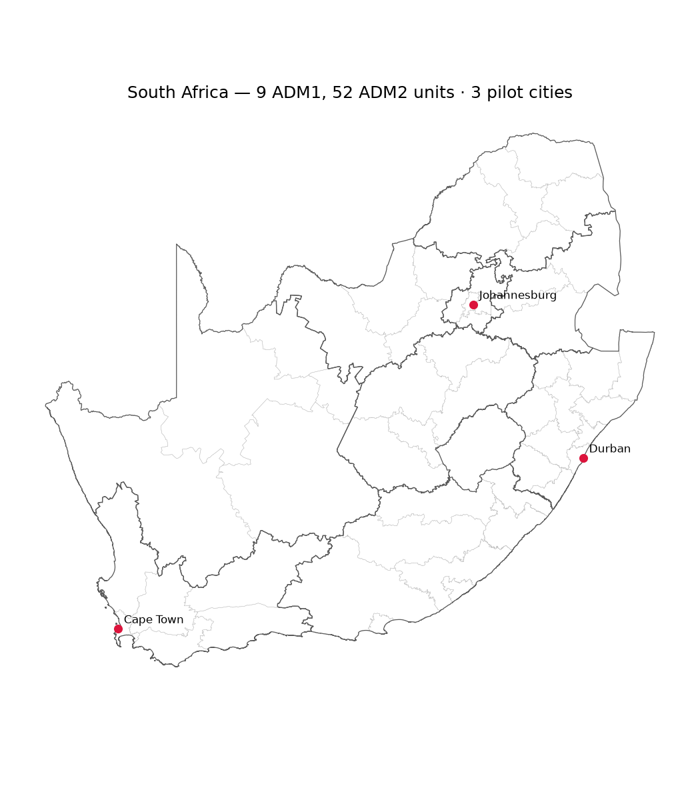
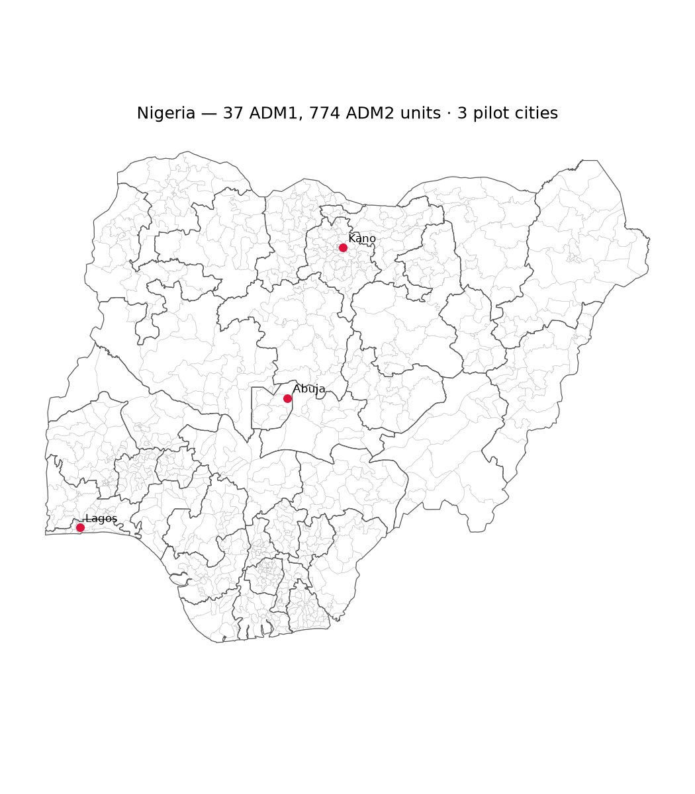
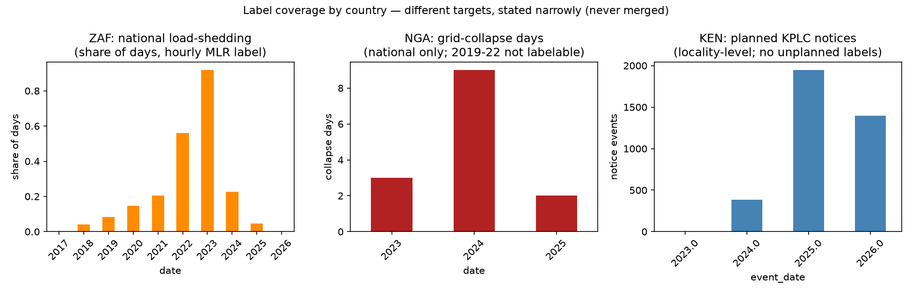

# Day 13 — Coverage atlas: where data exists (and does not)

Generated by `python -m src.eda.coverage_maps` on 2026-10-19T17:24:22+00:00.

Status counts: `{'available': 17, 'partial': 3, 'absent': 2}` — every count in this report is derived
from the files on disk at generation time.

## Figures

## Coverage table (derived, not asserted)

| country   | layer           | status    | coverage_detail                                                                                      | source                       |
|:----------|:----------------|:----------|:-----------------------------------------------------------------------------------------------------|:-----------------------------|
| KEN       | boundaries_adm0 | available | 1 units                                                                                              | Day 2 (geoBoundaries)        |
| KEN       | boundaries_adm1 | available | 47 units                                                                                             | Day 2 (geoBoundaries)        |
| KEN       | boundaries_adm2 | available | 290 units                                                                                            | Day 2 (geoBoundaries)        |
| KEN       | weather_hourly  | available | 3 cities, hourly ERA5 2021+                                                                          | Day 3 (Open-Meteo archive)   |
| KEN       | wb_context      | available | 15 indicator files, country-year rows (context only, never labels)                                   | Day 5 (World Bank)           |
| ZAF       | boundaries_adm0 | available | 1 units                                                                                              | Day 2 (geoBoundaries)        |
| ZAF       | boundaries_adm1 | available | 9 units                                                                                              | Day 2 (geoBoundaries)        |
| ZAF       | boundaries_adm2 | available | 52 units                                                                                             | Day 2 (geoBoundaries)        |
| ZAF       | weather_hourly  | available | 3 cities, hourly ERA5 2021+                                                                          | Day 3 (Open-Meteo archive)   |
| ZAF       | wb_context      | available | 15 indicator files, country-year rows (context only, never labels)                                   | Day 5 (World Bank)           |
| NGA       | boundaries_adm0 | available | 1 units                                                                                              | Day 2 (geoBoundaries)        |
| NGA       | boundaries_adm1 | available | 37 units                                                                                             | Day 2 (geoBoundaries)        |
| NGA       | boundaries_adm2 | available | 774 units                                                                                            | Day 2 (geoBoundaries)        |
| NGA       | weather_hourly  | available | 3 cities, hourly ERA5 2021+                                                                          | Day 3 (Open-Meteo archive)   |
| NGA       | wb_context      | available | 15 indicator files, country-year rows (context only, never labels)                                   | Day 5 (World Bank)           |
| KEN       | label_planned   | available | 3740 notice events, locality/county level (2023-10 .. 2026-10)                                       | Day 11 (KPLC notices)        |
| KEN       | label_unplanned | absent    | by design: KPLC publishes planned notices only (Day 7 audit)                                         | —                            |
| ZAF       | label_unplanned | available | national hourly MLR, 3470 days (2017-04 .. 2026-09)                                                  | Day 15 (Eskom MLR)           |
| NGA       | label_unplanned | partial   | national collapse days, 1096 days (2023-2025 only; 2019-22 counts-only era, never published reports) | Day 17 (NERC)                |
| NGA       | events_dated    | partial   | 14 dated events {2023: 3, 2024: 9, 2025: 2}; national-only granularity                               | Day 10 (NERC annual reports) |
| KEN       | events_dated    | absent    | no unplanned-event source passed the Day 7 go/no-go                                                  | —                            |
| ZAF       | events_dated    | partial   | the MLR label IS the event series; no per-event geocoded table                                       | Day 4/15                     |

## Known gaps — stated, never papered over

- **KEN has no unplanned-outage labels.** KPLC publishes planned
  interruption notices only (Day 7 audit); notice events are therefore
  modeled as *planned* supply interruptions and never relabeled.
- **NGA labels are national and windowed.** Grid collapses are whole-grid
  events; 2019-2022 are outside the labelable window (counts-only era /
  unpublished reports, Day 10) — absence of a row is not absence of a
  collapse.
- **ZAF labels are national.** The MLR series is a national hourly signal;
  province-level attribution would be fabricated granularity.
- **5 duplicate NGA ADM2 names** (Day 12) surface as ambiguity flags in
  any name join — resolved only with parent context or coordinates.
- **Weather is ERA5 reanalysis** (past only); day-ahead forecast weather
  was a documented NO-GO (WX-5/6) and is absent by decision, not neglect.
